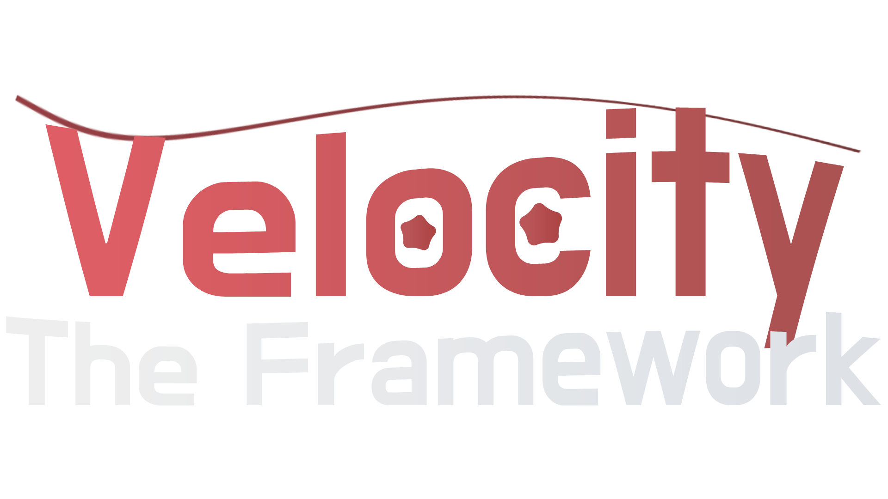

<p>
    <div align="center">
        
    </div>
    <div align="center">
        <br><br>
        <a href="https://github.com/null-pointer-9341/Velocity/releases/latest"></a>
        <a href="LICENSE.txt"></a>
        
    </div>
    <div align="center">
        👉 You can check the <a href="https://github.com/null-pointer-9341/Velocity/commits/development/">commit history</a> here!
    </div>
</p>

## 💿 Installation

In order to download and use Velocity, you can use the [installation manual](./INSTALLATION.md).

## ⚙️ Hardware requirements

I have *NOT* tested the hardware requirements for this project, but the hardware requirements should not be very needy.

I'm using a 14 year old CPU, and it works fine (well it's literally just a compiler and encoder, I would be shocked if it didn't work 😭).

Meaning you could probably run this compiler on a microwave.

## 💾 Operation system support

Most operating systems will be supported, everything outside this *can* still be supported (like other distros) but **likely** won't work

- [ ] Windows 7/10/11 support
- [x] Linux Debian support
- [x] Linux Ubuntu support
- [x] Linux Arch support
- [x] Linux Mint support

## 💡 Vision

The vision in `Velocity` is to create a source code compiler like [Rojo](https://rojo.space/). (Rojo isn't a compiler like mine, since it just syncs changes)

I also wanted to create a Framework that simplifies client and server communication.

This entire project was created due to the fact that collaboration in studio is kind of lacking, for external text editor / IDE support and version control (by Git).

## ✨ Features

* There's a built in Framework, which allows you to use services and signals, which are extremely important for client/server communication and module/module communication.
* The compiler allows you to use `_framework` and `_signal` which will just compile into `require(game:GetService("ReplicatedStorage").Velocity.Framework/Signal)`.
* You can use external text editors or an IDE to write code (which also allows for better auto complete).
* Feel free to use the `GitHub CLI` to collaborate with your team / friends.

## 🗺️ Overview

* You can learn to collaborate [here](./CONTRIBUTING.md).
* If you want, you can read the license [here](./LICENSE.txt).
* Found an issue? Report it [here](https://github.com/null-pointer-9341/Seworks/issues).

## 🤔 How it works

Velocity works like a small project pipeline: you organize your game code into `src/server`, `src/client`, and `src/shared`, then run the CLI to package it into a `.vrtx` file.

So it's extremely simple, well I'll just show you some examples:

1. `velocity init` - This will create all the source folders like `src/server`.
2. `velocity config` - Creates the `config/project.json` so you can edit the project name (will show in studio) and the version (doesn't really do anything but looks cool)
3. `velocity build` - Checks every script in those folders and turns it into a scene tree (folders also work).
4. The compiler turns all these file extensions into the following types:
   - `*.server.luau` turns into `Script`
   - `*.client.luau` turns into `LocalScript`
   - `*.luau` turns into `ModuleScript`
5. The final result (after you run `velocity build`) is *ALLWAYS* gonna be under `build/<project-name>.vrtx`.

When the framework is enabled with `velocity build -f`, Velocity also rewrites special aliases inside your source code. Tokens like `_framework` and `_signal` are replaced with the framework require calls.

## ❓ How was it created

Mostly, this was just assets taken from my other project, `Seworks`, taken and integrated into the CLI, and some additional features.

This was mainly integration hell.

Also I started commits quite late in development, which forced me to re-check all my changes to give the commit a proper message.

## 🔧 How to use it

You can follow the [installation guide](./INSTALLATION.md) to find out how to use it, and how to install it.

## 🧩 Framework

### Setup

You can build the framework by adding a `-f` parameter to your `build` command.

Like this:
```bash
velocity build -f
```

### API and Client Communication

You can create a service by typing `velservice` (if you have the snippets installed).

You can expose server methods and remote signals when you put them into a services `Client` table:

```lua
local Framework = require(game:GetService("ReplicatedStorage").Velocity.Framework)

local ProfileService = Framework.CreateService({
    Name = "ProfileService",
    Client = {
        GetProfile = function(self, player)
            return { Name = player.Name }
        end,
        ProfileUpdated = Framework.CreateRemoteSignal(),
        Report = Framework.CreateRemoteSignal(),
    },
})

ProfileService.Client.Report:Connect(function(player, report)
    print(player.Name, report)
end)

return ProfileService
```

Clients get a service with the same name, remote function use colon syntax and remote signal callbacks on the server receive the `Player` first.

```lua
local Framework = require(game:GetService("ReplicatedStorage").Velocity.Framework)
local ProfileService = Framework.GetService("ProfileService")

local profile = ProfileService:GetProfile()
ProfileService.ProfileUpdated:Connect(function(updatedProfile)
    print(updatedProfile.Name)
end)
ProfileService.Report:FireServer("Loaded profile")
```

Use `ProfileService.Client.ProfileUpdated:Fire(player, profile)` to notify one client, or `:FireAll(profile)` to notify everyone. Always check and validate client provided arguments in server methods, since exploiters can fire them using... exploits.

## 🤝 How to collaborate

Check out [contributing](./CONTRIBUTING.md) to learn about collaboration.

## 🔗 Summary

Velocity is a collaboration helper, you can work with your team or anyone using `Git` or any other cloud service.

Also allows for better control due to services and networking, and makes it easier to write code (snippets).

And well, it's just cool as heck!